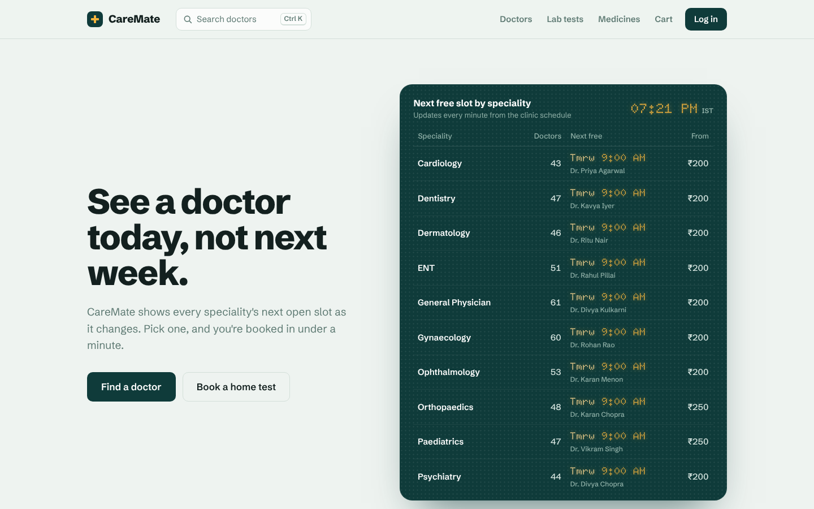
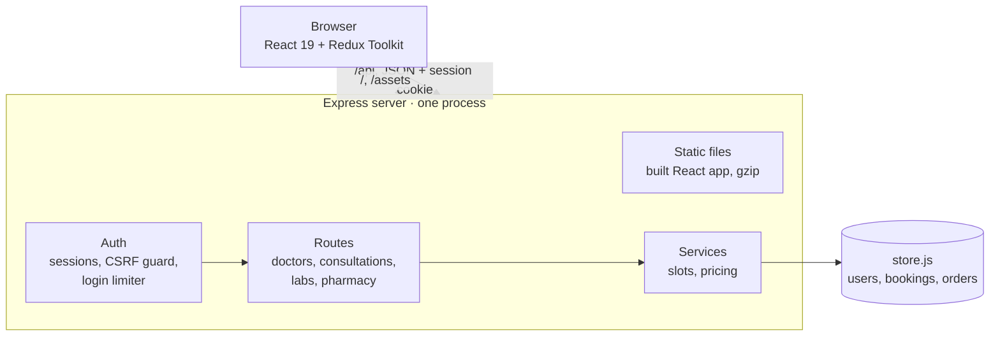
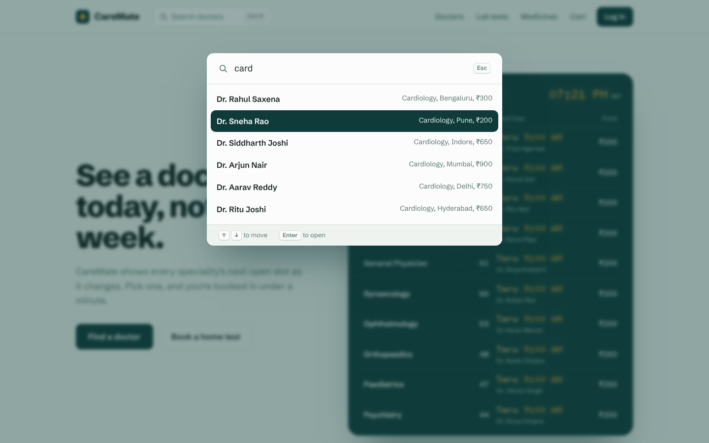

# CareMate: doctor, lab test and medicine booking with a live availability board


**Live demo:** [caremate-9nkr.onrender.com](https://caremate-9nkr.onrender.com) · **Author:** [Mahendra Meena](https://github.com/Mahendr99ar)

CareMate is a healthcare booking web app built with **React, Redux Toolkit and Express**. The home
page shows every speciality's **next free slot**, styled like the LED token board in a hospital
waiting room, and updates as people book. Patients can book a video or clinic consultation, schedule
a home sample pickup and order medicines, and the server makes sure **two people can never book the
same slot**, even when they press the button at the same moment.





## Features

| Area | What is implemented |
|---|---|
| Availability board | Earliest free slot per speciality, the doctor who has it and the lowest fee; polls every minute and refreshes right after a booking |
| Booking | 7-day slot picker that skips the lunch hour and times already past in IST; the server rechecks the slot at booking time and answers `409` if someone got there first |
| Doctors | 500 doctors, filters by speciality and city, debounced search, four sort orders; filters live in the URL so Back and shared links work; virtualized list |
| Quick search | Ctrl+K / ⌘K or `/` from any page opens a keyboard-driven search over doctors and pages (ARIA combobox) |
| Auth | Cookie sessions (`httpOnly`, `SameSite=Lax`, `Secure` over HTTPS), session id regenerated on login, 5 wrong passwords lock an email for 15 minutes, any `401` sends the user back to login |
| Lab tests | Several tests in one booking, home collection windows capped at 3 homes each, fasting warnings |
| Pharmacy | Redux cart saved to `localStorage`, server-side pricing that ignores prices sent by the browser, prescription medicines flagged |
| My bookings | Consultations, lab tests and orders in keyboard-operable tabs, with cancel and a confirmation dialog |
| Testing | 22 API tests (node:test + supertest), 23 UI tests (Vitest + Testing Library), a Playwright run through the whole app, and a booking race test |

## Results

Measured on a 2-vCPU Linux VM running the production build, with the load generator
([autocannon](https://github.com/mcollina/autocannon), 20 connections for 10 s) on the same machine.

| Test | Result |
|---|---|
| 50 accounts book the same slot at the same moment | **1 booked, 49 refused** with `409`, 0 errors |
| Doctor list API (filter by speciality, sort by rating) | **~1,750 req/s**, p50 9 ms, p99 24 ms, 0 errors |
| Availability board API | **~480 req/s**, p50 37 ms, p99 89 ms, 0 errors |
| Board profiling fix (see below) | **~11×** throughput (44 → ~480 req/s), p50 431 → 37 ms |
| gzip on the Express server | Home page **514 → 255 KB** transferred, JavaScript 353 → 115 KB |
| Virtualized doctor list | **11 of 500** rows in the DOM at a time |
| Lighthouse, mobile emulation (local production build) | Performance 80 to 86, Accessibility **100**, Best practices **100**, SEO **100** |

**The board fix.** A CPU profile showed most of each board request going into converting the
clock to IST, which ran once per doctor (1,000 times per request), and into rebuilding every
doctor's slot list from strings. Now the time is converted once per request, each doctor's working
day is built once and cached, and bookings are grouped by doctor before the scan. One board now
takes 3.4 ms to build, and 6.6 ms with 10,000 bookings in the system.

## Quick start

Requires Node 20+.

```bash
npm run setup                 # install server and client packages
npm test                      # 22 API tests + 23 UI tests

npm run server                # terminal 1: API on http://localhost:4000
npm run client                # terminal 2: open http://localhost:5173
```

Run it exactly as Render does, one process serving the API and the built app:

```bash
npm run build
NODE_ENV=production SESSION_SECRET=local-test npm start     # open http://localhost:4000
node server/scripts/race-test.js http://localhost:4000 50     # 50 simultaneous bookings, expects 1 to win
```

Deploying: push to GitHub, then **New > Blueprint** on Render. `render.yaml` sets the build and
start commands, `NODE_ENV`, a generated `SESSION_SECRET` and the `/api/health` check.

## API

| Method | Path | Description |
|---|---|---|
| `POST` | `/api/auth/register` · `/login` · `/logout` | body `{name?, email, password}`; sets or clears the session cookie |
| `GET` | `/api/auth/me` | the signed-in user, or `{"user": null}` |
| `GET` | `/api/doctors` | `?search=&speciality=&city=&sort=rating\|fee_asc\|fee_desc\|experience&page=&limit=` |
| `GET` | `/api/doctors/board` | next free slot, doctor count and lowest fee per speciality |
| `GET` | `/api/doctors/{id}/slots` | `?date=YYYY-MM-DD`; every slot that day with `available` true or false |
| `GET` `POST` | `/api/consultations` | your bookings; book with `{doctorId, date, time, mode}`, `409` if the slot is gone |
| `PATCH` | `/api/consultations/{id}/cancel` | cancel one of your own bookings |
| `GET` | `/api/lab-tests` · `/api/lab-tests/collection-slots` | test catalogue; `?date=` gives windows with spots left |
| `GET` `POST` | `/api/lab-bookings` | your lab bookings; book with `{testIds, date, time, address}` |
| `GET` | `/api/medicines` | `?search=` |
| `GET` `POST` | `/api/orders` | your orders; order with `{items: [{medicineId, quantity}], address}`, priced on the server |
| `GET` | `/api/health` | `{"ok": true}` for Render's health check |

Every write must be `application/json`; anything else gets `415`.

## Project structure

```
server/src/
  app.js            Express app: gzip, sessions, routes, and the built React app in production
  routes/           auth, doctors (+ board), consultations, labs, pharmacy
  services/
    slots.js        working hours to bookable slots, cached per doctor
    pricing.js      order totals; the only place prices are decided
  middleware/       CSRF guard, login limiter, auth check, error handler
  data/store.js     JSON-backed store; the only file that knows about storage
  utils/clock.js    "today" and "now" in IST
server/scripts/
  race-test.js      many accounts book one slot at once; exactly one must win
server/test/        API and slot tests
client/src/
  services/api.js   every endpoint as RTK Query, plus the session-expiry check
  app/store.js      Redux store and cart persistence
  features/         home board, doctors, labs, pharmacy, cart, bookings, auth
  components/       UI kit (Button, Modal, ChoiceChips...) and layout (Navbar, command palette)
  styles/global.css design tokens and all styles
```

## Design decisions

* **Cookie sessions instead of a JWT in localStorage.** JavaScript can't read an `httpOnly`
  cookie, so an XSS bug can't steal the session. CSRF is handled by `SameSite=Lax` plus a server
  rule that rejects any write that isn't JSON, which a plain HTML form can't send.
* **The server decides prices and availability.** The cart shows a total for convenience, but the
  order endpoint looks every price up itself. Slot checks and inserts run in the same synchronous
  block on Node's single thread, so no other request can slip in between; the race test above
  checks this.
* **RTK Query for server data, a slice only for the cart.** Booking invalidates the `Slots` tag,
  so the slot list and the home board refetch on their own. Queries for personal data are skipped
  until a signed-in user is known, so logging out can't trigger a stray `401`.
* **Clinic time is IST everywhere.** The server works out "today" in `Asia/Kolkata`; the client
  builds date strings from local parts, because `toISOString()` would turn 12:30 AM into the
  previous day.
* **One bold element.** The amber dot-matrix board (Doto typeface) carries the identity; the rest of
  the site stays in quiet pine and mint (Schibsted Grotesk). Fonts are bundled, not loaded from
  Google, and the one animation is skipped for users who prefer reduced motion.

Fifteen bugs found while testing, and how each was traced, are written up in
[docs/CODE_REVIEW.md](docs/CODE_REVIEW.md).

## Limitations and next steps

* Sessions live in server memory and data in a JSON file, so both reset when the free Render
  instance restarts. Next step: Postgres for data and Redis for sessions.
* No payment step; "Pay & book" confirms straight away.
* Prescription upload is not built; orders that need one are only flagged.
* Next: an AngularJS admin panel for managing bookings, joined to the React app as a micro frontend.


