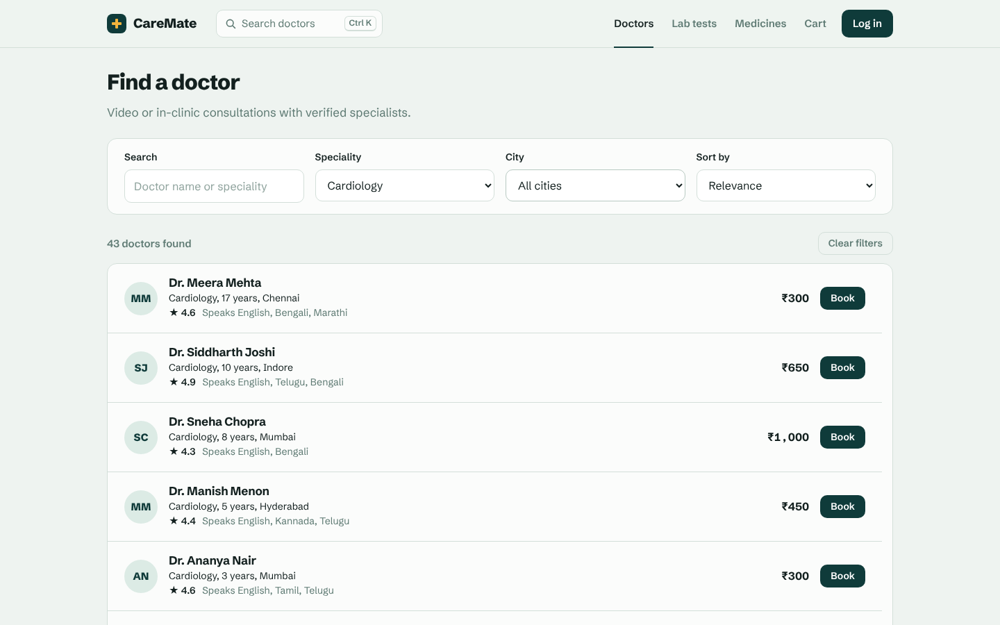
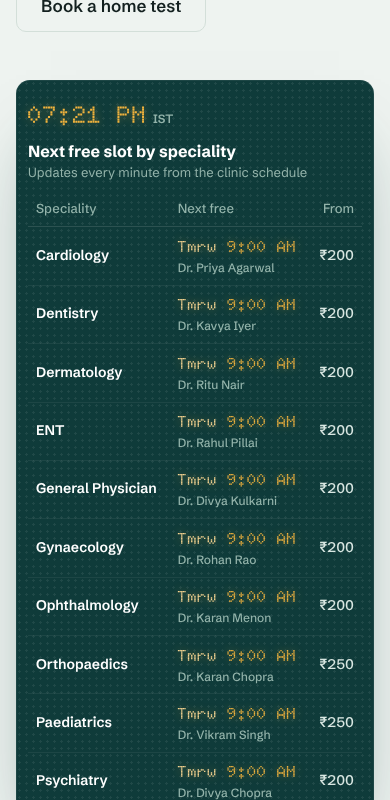

# CareMate

A healthcare booking web app: see every speciality's next free slot live, book a video or clinic consultation, schedule a home lab-test pickup, order medicines, and manage it all from one page.

Frontend: **React 19, Redux Toolkit (RTK Query), React Router, react-window**
Backend: **Node.js, Express 5, cookie-based sessions (express-session), bcrypt**


## Features

| Area | What it does |
|---|---|
| Availability board | The home page shows each speciality's earliest free slot, the doctor who has it and the lowest fee, styled like a hospital OPD token display. It polls every minute and refreshes immediately after you book. |
| Quick search | Press Ctrl+K (⌘K on Mac) or `/` anywhere to search doctors and pages from the keyboard. Arrow keys move, Enter opens. |
| Auth | Register, log in, log out. The session lives in an `httpOnly`, `SameSite=Lax` cookie, marked `Secure` over HTTPS. The session id is regenerated on login, and five wrong passwords lock the email for 15 minutes. If the session ends (expired, logged out in another tab, server restart), the next request sends you to the login page. |
| Doctors | 500 doctors, filters by speciality and city, debounced search, four sort orders. Filters live in the URL, so a search can be shared or restored with Back. The list is virtualized. |
| Consultations | Pick a date in the next 7 days and a free slot. Slots skip the lunch hour and times already past (IST). The server rechecks the slot when you book, so two people can't take the same one. |
| Lab tests | Choose several tests, a collection window (at most 3 homes per window) and an address. Tests that need fasting show a warning. |
| Pharmacy | Cart in Redux, saved to `localStorage`. Free delivery above ₹499. The server recalculates every price. Prescription medicines are flagged. |
| My bookings | Tabs for consultations, lab tests and orders, with cancel and a confirmation dialog. Arrow keys switch tabs. |

## Running locally

Needs Node 20 or newer.

```bash
npm run setup      # installs server and client packages

npm run server     # terminal 1: API on http://localhost:4000
npm run client     # terminal 2: app on http://localhost:5173
```

The Vite dev server proxies `/api` to port 4000, so the browser sees one origin and the session cookie works without CORS.

```bash
npm test           # 22 API tests + 23 frontend tests
npm run lint
```

## Deploying to Render

In production one Express server serves both the API and the built React app.

1. Push this folder to a GitHub repository.
2. On Render, choose **New > Blueprint** and pick the repository. `render.yaml` sets everything up: the build and start commands, `NODE_ENV=production`, a generated `SESSION_SECRET`, and a health check on `/api/health`.
3. Open the URL Render gives you.

To set it up by hand instead, create a Web Service with build command `npm run build`, start command `npm start`, and the two environment variables above.

On Render's free plan the server goes to sleep when nobody has visited for a while, and the next visit can take up to a minute while it wakes. The disk is also wiped on every restart or deploy, so accounts and bookings reset. That is fine for a portfolio demo; see Known limitations.

## Project structure

```
server/src
  app.js               builds the Express app; in production also serves client/dist
  routes/              one router per resource
  services/slots.js    turns doctor hours into bookable slots
  services/pricing.js  order totals, the single source of truth for prices
  middleware/          CSRF guard, login limiter, auth check, error handler
  data/store.js        small JSON-backed store; the only file that knows about storage

client/src
  services/api.js      every API call as RTK Query endpoints, plus the session-expiry check
  app/store.js         Redux store and cart persistence
  components/ui/       Button, TextField, Modal, ChoiceChips, QuantityStepper
  components/layout/   Navbar, command palette, protected route
  features/<area>/     pages and components grouped by feature
  styles/global.css    design tokens and all styles
```

## Design

The home page opens with the thing patients care about most: how soon they can be seen. The board borrows the look of the amber LED token displays in Indian hospital waiting rooms, set in the Doto dot-matrix face. It is the only bold element; the rest of the site stays quiet so the board carries the identity.

- Colours: pine `#0F3B3A`, mint paper `#EEF3F0`, ink `#13201F`, LED amber `#F2B33D` (used only on the board), sage `#5E7A73`.
- Type: Schibsted Grotesk everywhere, Doto only for the board's times. Fonts are bundled with the app rather than loaded from Google.
- Motion: one moment. Board rows flip into place on load like a split-flap display. Nothing animates for users who prefer reduced motion.

## Decisions worth explaining

**Cookie sessions instead of a JWT in localStorage.** JavaScript can't read an `httpOnly` cookie, so an XSS bug can't steal the session. The trade-off is CSRF, handled two ways: `SameSite=Lax` keeps the cookie off cross-site POSTs, and the server rejects writes that aren't `application/json`, which a plain HTML form can't send.

**RTK Query for server data, a slice only for the cart.** Doctors, slots and bookings belong to the server, so they live in RTK Query's cache. Booking a slot invalidates the `Slots` tag, so the slot list and the home board refetch on their own. The cart exists only in the browser, so it is the one hand-written slice.

**Queries for personal data wait for a known user.** Bookings and orders are skipped whenever no signed-in user is known. Logging out clears the cache, and without this the bookings page could refetch in the moment before it unmounts and get a 401.

**Virtualized doctor list.** Rendering all 500 rows would put every one in the DOM and make scrolling and filtering slow on cheap phones. `react-window` keeps about ten rows mounted. The row renderer is defined outside the page component; an inline function there would be a new component type on every render and remount every row.

**Server owns prices and availability.** The client shows totals for convenience, but the order endpoint looks up every price itself and ignores anything the browser sends.

**Time zones.** Clinic hours are IST. The server works out "today" and "now" in `Asia/Kolkata`; the client builds date strings from local date parts instead of `toISOString()`, which would shift 12:30 AM to the previous day.

## Accessibility

Labelled form fields with linked hints and errors, a skip link, visible focus rings, radio-based date and slot pickers, a modal that traps focus and returns it on close, a command palette built as an ARIA combobox, keyboard-operable tabs, and `prefers-reduced-motion` support.

## Known limitations

- Sessions use the in-memory store from `express-session`, so they are lost on restart and won't work across several servers. Production would use Redis (`connect-redis`).
- `db.json` is rewritten on every change and is wiped on Render's free plan. A real deployment needs a database.
- No payment step; "Pay & book" confirms directly.
- Prescription upload is not built; orders that need one are only flagged.

## Performance

Run Lighthouse in Chrome DevTools on the deployed site and record your numbers here.

| Page | Performance | Accessibility | Best practices |
|---|---|---|---|
| / | [your score] | [your score] | [your score] |
| /doctors | [your score] | [your score] | [your score] |

## Screenshots

| Quick search | Doctor list |
|---|---|
|  |  |


